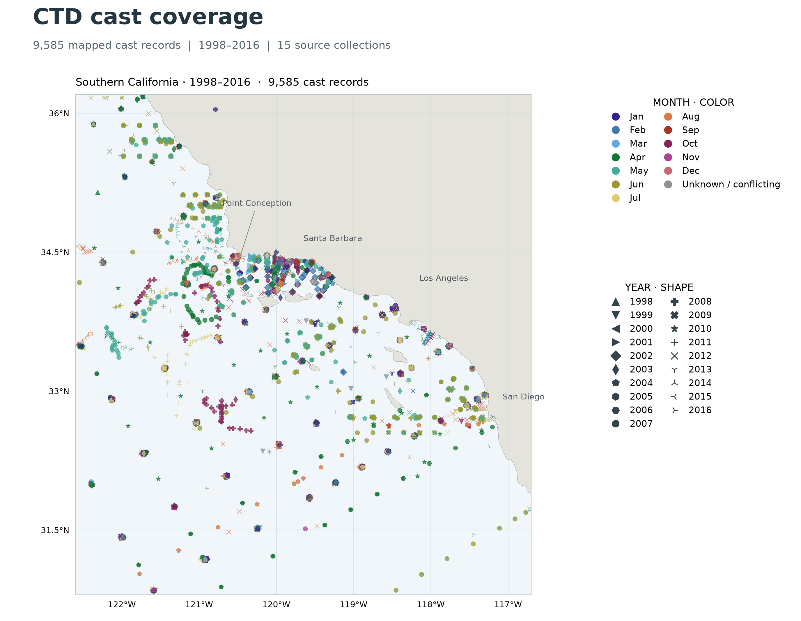

# MLML MS 274 Class Project: Satellite Wind, Ocean Color, and Machine Learning

## Abstract

This project uses satellite-derived wind and ocean color to examine physical and biological variability around CTD casts and validate a Regional Ocean Modeling System (ROMS) model for biological use in my thesis. My thesis examines relationships between dissolved oxygen (DO), spiciness, and larval *Sebastes* species. In order to validate the ROMS model, I will compare CTD casts to ROMS-modeled spiciness and DO in a depth band around 50 m from 1998–2016. However, CTD casts can be influenced by local conditions that the model's coarse resolution may not show, like submesoscale eddies <1 km in scale that its 1 km grid cannot resolve. This project seeks to determine whether these local factors are affecting an individual CTD cast, while also comparing modeled temperature and salinity with the observations. Because I have around 9,500 casts to evaluate, I will use machine learning to make a framework that automates inclusion/exclusion of CTD casts based on the presence of sub-1 km submesoscale eddies.

I will use satellite wind and chlorophyll-a data to examine whether recent wind forcing and phytoplankton variability differ between the CTD classes and are associated with differences between observed and modeled DO. Wind provides context for mixing and upwelling, while ocean color describes surface phytoplankton conditions. Phytoplankton production can increase DO, while respiration and decomposition of organic matter can decrease DO below the surface, as described by Kessouri et al. (2024). Comparing these satellite observations with the machine-learning classifications will connect surface variability to the CTD profiles and the model's performance near 50 m.

## Project Outline

### Datasets

- CTD casts from CalCOFI, Plumes and Blooms (UCSB), and RREAS with temperature, salinity, and dissolved oxygen, 1998–2016.

- The 1 km ROMS model outputs associated with Kessouri et al. (2024) for DO, salinity, and temperature, with spiciness calculated from temperature and salinity.
- Satellite data, with both sources covering the 1998–2016 study period:
  - **Wind:** [RSS CCMP Version 3.1](https://podaac.jpl.nasa.gov/dataset/CCMP_WINDS_10M6HR_L4_V3.1), providing six-hourly surface wind vectors at 10 m on a 0.25° grid. 
  - **Ocean color:** [ESA Ocean Colour Climate Change Initiative (OC-CCI) Version 6.0](https://www.oceancolour.org/thredds/catalog-cci.html?dataset=CCI_ALL-v6.0-1km-DAILY), providing daily surface chlorophyll-a on a 1 km grid from multiple ocean-color satellites (Sathyendranath et al., 2019). 

### Figures

1. Maps of satellite chlorophyll-a with wind vectors and CTD cast locations, colored by machine-learning class, for selected cruises.
2. Plots of buoyancy versus depth for submesoscale and non-submesoscale classes labeled by the machine-learning models.
3. Density plots of the observed-versus-modeled error for salinity, temperature, and dissolved oxygen for accepted casts.
4. Distributions of preceding wind and chlorophyll conditions by CTD class, alongside DO error, to show how satellite-observed variability relates to the classifications and model comparison.

### Overall Approach

1. Match satellite wind and chlorophyll data to CTD cast locations and dates. Summarize alongshore wind over the preceding 3 and 7 days and chlorophyll over the preceding 7 and 14 days. These windows will provide starting points for comparing recent forcing and biological variability. Apply the satellite products' quality flags and record valid coverage, retaining cloud-obscured chlorophyll as missing data.
2. Identify submesoscale eddies based on CTD casts using the profile classification model (PCM) framework described by Yao et al. (2025) to detect differences in depth–buoyancy plots.
3. Train an unsupervised convolutional neural network (CNN) to identify larger (>1 km) submesoscale eddies that can be seen in the ROMS model. Use separate cruises for training and testing the machine-learning framework.
4. Test whether the PCM can identify larger submesoscale eddies observed in the ROMS model.
5. If so, use the PCM framework to exclude smaller (<1 km) submesoscale eddies from the ROMS comparison.
6. Compare standard-deviation-corrected root mean square error (RMSE) of the ROMS model against accepted CTD casts to determine how well the model predicts larger-scale dynamics.
7. Compare satellite-derived wind and chlorophyll conditions between CTD classes and examine their relationships with observed DO and ROMS–CTD DO error. Account for season and region when comparing classes. This analysis will test whether recent wind forcing and surface phytoplankton variability help explain the conditions associated with accepted and excluded casts.

## References

Kessouri, F., Sutula, M. A., Bianchi, D., Ho, M., Damien, P., McWilliams, J. C., Frieder, C. A., Renault, L., Frenzel, H., McLaughlin, K., & Deutsch, C. (2024). Cross-shore transport and eddies promote large scale response to urban eutrophication. *Scientific Reports, 14*, 7240. [https://doi.org/10.1038/s41598-024-57626-6](https://doi.org/10.1038/s41598-024-57626-6)

Remote Sensing Systems. (2024). *RSS CCMP 6-hourly 10 meter surface winds Level 4 Version 3.1* [Data set]. NASA Physical Oceanography Distributed Active Archive Center. [https://doi.org/10.5067/CCMP-6HW10M-L4V31](https://doi.org/10.5067/CCMP-6HW10M-L4V31)

Sathyendranath, S., et al. (2019). An ocean-colour time series for use in climate studies: The experience of the Ocean-Colour Climate Change Initiative (OC-CCI). *Sensors, 19*(19), 4285. [https://doi.org/10.3390/s19194285](https://doi.org/10.3390/s19194285)

Yao, L., Taylor, J. R., Jones, D. C., & Bachman, S. D. (2025). Identifying ocean submesoscale activity from vertical density profiles using machine learning. *Earth and Space Science, 12*(1), e2022EA002618. [https://doi.org/10.1029/2022EA002618](https://doi.org/10.1029/2022EA002618)
